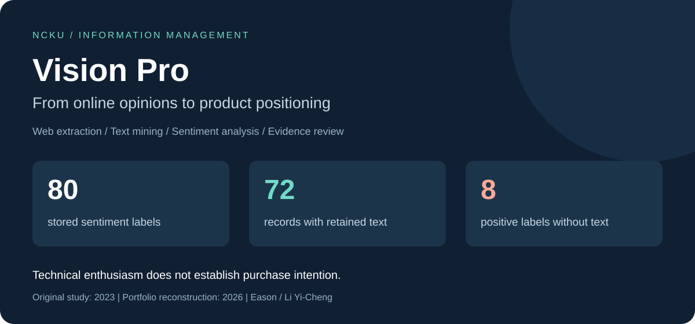
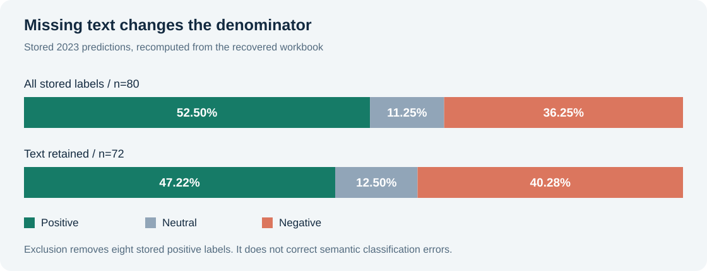

# Vision Pro：從網路輿情到產品定位

**Apple Vision Pro Social Listening · Web Scraping · Text Mining · Sentiment Analysis**

[English](README.en.md) · [專案報告 PDF](docs/vision-pro-case-study.pdf) · [分析方法](docs/methodology.md) · [資料品質與結果](docs/findings.md) · [重現指南](docs/reproduce.md)



## 這個研究想回答什麼？

2023 年，生成式 AI 成為科技討論焦點時，Apple 發表 Vision Pro，讓 AR、MR 與空間運算再次進入產品策略討論。我想理解：**網路上的技術期待，是否也代表消費者願意購買？價格、用途與內容生態系各自形成哪些門檻？**

這份個人研究將科技媒體、部落格與 PTT 討論中的非結構化文字，整理為可分析的資料，再結合情緒標籤與中文詞雲，提出產品定位與價格策略的研究方向。

**作者：李奕成 Eason｜國立成功大學 Information Management｜原始研究：2023｜專案整理：2026**

## 從哪裡開始看

| 想了解的能力 | 可以檢查的內容 |
| --- | --- |
| 網路資料蒐集與爬蟲 | [HTML 擷取程式](src/visionpro/scrape.py)：PTT 評論節點、新聞內文、來源追蹤、去重與 IP 排除；附合成 HTML 測試 |
| 資料處理 | [逐筆歷史標籤](data/historical_scores.csv)：80 筆資料的列號、文字存在狀態、雜湊、來源及分數，可核對空白值與分析分母 |
| 情緒分析 | [重算程式](src/visionpro/audit.py) 與 [結果解讀](docs/findings.md)：Azure 歷史輸出、分組平均、資料品質影響、否定句誤判 |
| 文字探勘 | [POS 篩選與 TF-IDF](src/visionpro/text_mining.py)：歷史詞性詞頻、停用詞、大小寫正規化；TF-IDF 使用明確標示的合成文件示範 |
| 資料視覺化 | 原研究使用 Power BI 詞雲；本專案提供 [可重建的結果圖](assets/sentiment-comparison.svg) 與 [PDF 個案報告](docs/vision-pro-case-study.pdf) |
| 商業分析 | [研究結論](docs/findings.md#產業與消費者的用途)：由技術期待與購買門檻，提出需要進一步驗證的產品與溝通方向 |

## 一個值得保留的發現：資料品質會改變故事

| 分析口徑 | 正面 | 中立 | 負面 | 平均既有分數 |
| --- | ---: | ---: | ---: | ---: |
| 原始 80 筆儲存標籤 | 42 / 52.50% | 9 / 11.25% | 29 / 36.25% | 0.500342 |
| 僅保留有文字的 72 筆 | 34 / 47.22% | 9 / 12.50% | 29 / 40.28% | 0.482481 |



原報告將占比四捨五入為 53%、11%、36%。本次讀取原始試算表時，發現 **8 筆文字空白的紀錄仍帶有 positive 標籤，而且分數皆為 0.6611**。這解釋了為何需要同時公布 80 筆與 72 筆兩種口徑。空白文字的成因尚無證據；不能認定模型當時收到的輸入一定也是空白。

排除空白後，正面仍是最多的單一標籤，但已未過半。這只是修正分析分母；既有標籤仍有語意誤判，也沒有人工真值集，因此不能把它當成購買意願或模型準確率。

## 分析流程


原研究保留了 Excel／Google Sheets 的蒐集、清理、翻譯、情緒與詞雲中間成果。本次以逐筆文字比對恢復來源歸屬，並補上 Python 擷取、重算與測試。**2023 年的原始爬蟲程式未找回；這裡的 Python 程式是 2026 年新增的可執行重建。**

## 快速執行

核心流程只使用 Python 3.10+ 標準函式庫，不需要金鑰或付費服務。在專案根目錄執行：

```bash
PYTHONPATH=src python3 -m unittest discover -s tests -v
PYTHONPATH=src python3 -m visionpro audit --output output/audit.json
PYTHONPATH=src python3 -m visionpro terms --output output/terms.json
PYTHONPATH=src python3 -m visionpro scrape --input tests/fixtures/ptt_synthetic.html --kind ptt --output output/ptt.json
PYTHONPATH=src python3 -m visionpro tfidf --input tests/fixtures/segmented_synthetic.csv --output output/tfidf.json
```

前兩項分析重算歷史資料衍生檔；後兩項使用合成資料展示 HTML 擷取與文件詞權重。即時網站擷取為選用功能，須指定單一 HTTPS 網址及允許的網域，詳見 [重現指南](docs/reproduce.md)。本次驗證未重新爬取歷史網站，也未重新呼叫 Azure。

## 專案內容與證據

- [docs/vision-pro-case-study.pdf](docs/vision-pro-case-study.pdf)：重新撰寫的公開版研究報告，涵蓋目的、過程、結果及結論。
- [data/](data/)：逐筆分數衍生檔、來源目錄、歷史 POS 詞頻及資料來源說明；不含完整評論、帳號、IP 或原始雲端分享連結。
- [results/](results/)：歷史標籤重算、詞頻，以及明確區分的合成範例輸出。
- [docs/provenance.md](docs/provenance.md)：歷史成果、本次新增、來源修正與未完成驗證的界線。
- [docs/contribution.md](docs/contribution.md)：個人研究與本次 AI 協作整理的歸屬說明。

原始 11 頁報告、課程講義與完整文字資料留在本機私人封存。公開版本保留可核對的衍生證據，避免連帶公開課程教材及網友識別資訊。課程的 Moodle 截止日是歷史作業規範；本專案未執行 Moodle 提交。

